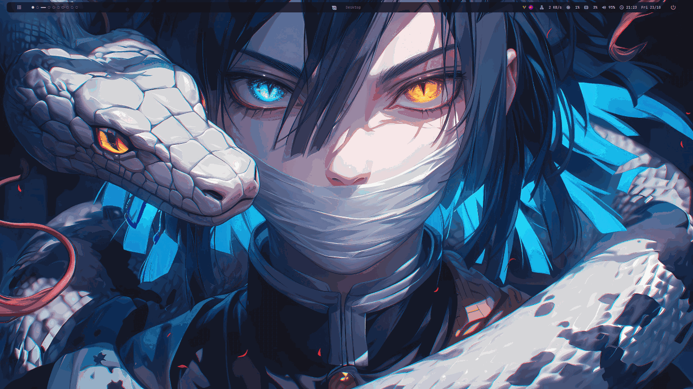

# Mint bspwm glass

A Caelestia-style (Material 3 dark, lavender) bspwm rice for Linux Mint: translucent glass
everywhere, a floating Polybar with Material Symbols icons, and Rofi popups (calendar, volume,
power) that slide out of the bar.



*Launcher → tiled kitty (neofetch, cmatrix, btop) → focus/swap → show desktop → workspace switch → calendar, volume OSD + popup, power menu.*

| Part | What it is |
|---|---|
| WM | bspwm + sxhkd |
| Compositor | picom v13 (blur, rounded corners, animations), with a v10 fallback |
| Bar | Polybar, workspace dots, Material Symbols icons, Mint logo |
| Launcher / popups | Rofi themes sharing one palette (`~/.config/rofi/colors.rasi`) |
| Notifications | Dunst with Material icons and a volume OSD |
| Terminal | kitty (translucent), btop with a matching `caelestia` theme |

This pack keeps XFCE installed and adds bspwm as a separate X11 session.

## 0. Recommended approach

Do NOT remove XFCE or LightDM.
At login you can choose either:
- Xfce Session
- bspwm

This makes rollback easy.

## 1. Install packages

On Linux Mint 22.x / Ubuntu Noble:

```bash
sudo apt update
sudo apt install \
  bspwm sxhkd picom polybar rofi kitty flameshot \
  feh dunst pavucontrol thunar firefox \
  x11-xserver-utils x11-utils \
  fcitx5 fcitx5-config-qt fcitx5-unikey \
  fcitx5-frontend-gtk3 fcitx5-frontend-qt5 \
  zsh fonts-jetbrains-mono \
  python3-gi gir1.2-gtk-3.0 light-locker \
  btop cmatrix
```

The icon fonts ship in `fonts/` and are installed to `~/.local/share/fonts` by
`install-configs.sh`: Material Symbols Rounded (all bar/popup icons) and
Symbols Nerd Font (the Linux Mint logo in the middle of the bar).

If `wpctl` is missing:

```bash
sudo apt install wireplumber
```

Optional for manual `startx` testing:

```bash
sudo apt install xinit xterm
```

## 2. Install the config pack

From the extracted folder:

```bash
chmod +x install-configs.sh
./install-configs.sh
```

The script backs up existing configs first.

## 3. Wallpaper

Put your wallpaper here:

```text
~/Pictures/Wallpapers/wall.jpg
```

Or edit the `WALL=` line in:

```text
~/.config/bspwm/bspwmrc
```

## 4. Ensure bspwm session appears in LightDM

Log out and check the session selector.

If `bspwm` is missing:

```bash
sudo cp session/bspwm.desktop /usr/share/xsessions/bspwm.desktop
```

Then log out again.

## 5. First login into bspwm

Expected hotkeys:

- Super + Enter: Kitty
- Super + Space: Rofi
- Super + Q: close window
- Super + F: fullscreen
- Super + Shift + Space: floating
- Super + H/J/K/L: focus
- Super + Shift + H/J/K/L: move/swap
- Super + 1..0: workspace
- Super + Shift + 1..0: move window to workspace
- Super + Shift + S: Flameshot region screenshot
- Super + Alt + R: reload bspwm
- Super + Alt + Q: logout bspwm
- Super + Shift + D: show desktop (hide / restore all windows)
- Super + [ / ]: previous / next workspace
- Volume keys: change volume (max 100%) with a dunst OSD

## 6. Polybar

Caelestia-style (Material 3 dark) translucent bar with Material Symbols icons:

- launcher (opens Rofi)
- bspwm workspaces as dots (focused = long pill, occupied = filled, empty = hollow)
- Linux Mint logo + active-window title
- system tray
- network, CPU, RAM
- volume
- time + date
- power button

Clicking some modules opens a Rofi popup attached right under the bar:

| Click | Popup |
|---|---|
| Time/date | Calendar. Left/Right or the arrow buttons change month; the calendar button jumps back to today. Clicking a day keeps it open; Esc or clicking outside closes it |
| Volume (left click) | Volume slider with -/+ (Left/Right keys too), mute button, output device picker, sound settings |
| Volume (middle / right click) | Toggle mute / open pavucontrol |
| Power | Lock, Suspend, Logout, Restart, Shutdown (the last three ask for confirmation) |

Files:

- `~/.config/polybar/scripts/` holds the popup scripts (`calendar.sh`, `volume.sh`, `powermenu.sh`, `popup-pos.sh`)
- `~/.config/rofi/colors.rasi` holds the shared colors; edit it to recolor the launcher and all popups at once
- `~/.config/rofi/{popup,calendar,volume,power}.rasi` are the popup themes
- `~/.config/dunst/dunstrc` styles notifications and the volume OSD

`popup-pos.sh` assumes the bar bottom is at y = 46 (`offset-y 8 + height 38`).
If you change the bar size, export `BAR_BOTTOM` or edit the default there.
Popups sit flush against the bar (square top corners, rounded bottom).
picom skips rounding and shadows for windows named `rofi - rofi-popup*`, and Rofi
draws the bottom corners itself (`border-radius` in `popup.rasi`). The Rofi
launcher still uses picom rounding, so keep its `border-radius` in
`config.rasi` equal to `corner-radius` in picom, otherwise blur leaks out at
the corners.

The lock button uses `light-locker-command -l` and falls back to `dm-tool lock`.

If Polybar does not appear:

```bash
~/.config/polybar/launch.sh
cat ~/.cache/polybar.log
```

### Wi-Fi note

The included network module uses:

```ini
interface-type = wired
```

If this Mint PC uses Wi-Fi, change it to:

```ini
interface-type = wireless
```

in `~/.config/polybar/config.ini`, then:

```bash
killall polybar
~/.config/polybar/launch.sh
```

## 7. Picom

Two configs ship in `~/.config/picom/`:

- `picom.conf` is for picom v13: popups slide out of the bar, notifications fly in from the right, windows scale + fade in
- `picom-legacy.conf` is for the system picom v10 (Mint 22 apt): no animations

`bspwmrc` starts `~/.local/bin/picom` (v13) with `picom.conf` when that binary exists, and
falls back to the system picom with `picom-legacy.conf` otherwise.

Build picom v13 (asks for sudo once to install build dependencies):

```bash
./build-picom.sh
```

To roll back to v10, delete `~/.local/bin/picom` and log in again.

Popups are matched by window name `rofi - rofi-popup` (first open: slide animation) and
`rofi - rofi-popup-re` (reopen after changing month / volume: shown instantly).

### NVIDIA legacy

The pack uses:

```conf
backend = "glx";
vsync = true;
blur-method = "dual_kawase";
blur-strength = 3;
```

If an older NVIDIA driver has glitches, first test:

```bash
killall picom
picom --backend xrender
```

If XRender is stable, set:

```conf
backend = "xrender";
```

and disable blur if needed.

## 8. Flameshot

Config includes:

```ini
useX11LegacyScreenshot=true
```

and bspwm autostarts Flameshot.

Hotkey:

```text
Super + Shift + S
```

If it does not open:

```bash
pkill flameshot
flameshot &
flameshot gui
```

## 9. Vietnamese Telex / UniKey

The pack adds these X11 variables:

```bash
GTK_IM_MODULE=fcitx
QT_IM_MODULE=fcitx
XMODIFIERS=@im=fcitx
GLFW_IM_MODULE=ibus
```

Open:

```bash
fcitx5-configtool
```

Add:
- Keyboard - English (US)
- Unikey

Configure Unikey:
- input method: Telex
- output charset: Unicode

Default switch key is normally Ctrl+Space.

Kitty specifically needs:

```bash
GLFW_IM_MODULE=ibus
```

which is already in `.xprofile`.

## 10. Zsh

Install:

```bash
sudo apt install zsh
```

Change login shell:

```bash
chsh -s "$(command -v zsh)"
```

Then fully log out and log back in.

Check:

```bash
getent passwd "$USER" | cut -d: -f7
echo "$SHELL"
ps -p $$ -o comm=
```

Kitty config deliberately does NOT force a shell.

## 11. Fastfetch / Neofetch

This pack does not auto-run either.
Add whichever you want to `~/.zshrc`.

If you use Fastfetch:

```bash
fastfetch
```

If `neofetch` is unavailable in Mint repositories, keep Fastfetch instead.

## 12. NVIDIA suspend/resume

Do NOT blindly copy CachyOS systemd settings to Mint.
First inspect:

```bash
systemctl status nvidia-suspend.service
systemctl status nvidia-resume.service
systemctl status nvidia-hibernate.service
```

If these services exist for your installed NVIDIA driver and are disabled, you can enable them:

```bash
sudo systemctl enable nvidia-suspend.service
sudo systemctl enable nvidia-resume.service
sudo systemctl enable nvidia-hibernate.service
```

Then test:

```bash
systemctl suspend
```

If power-button wake works but keyboard/mouse wake does not, inspect:

```bash
cat /proc/acpi/wakeup
```

Do not enable random ACPI devices unless you know which USB controller owns the keyboard/mouse.

## 13. Rollback

At LightDM simply select Xfce Session.

To restore configs, use the backup directory created by `install-configs.sh`, for example:

```text
~/.config-backup-bspwm-YYYYMMDD-HHMMSS
```

No XFCE files are removed by this pack.
